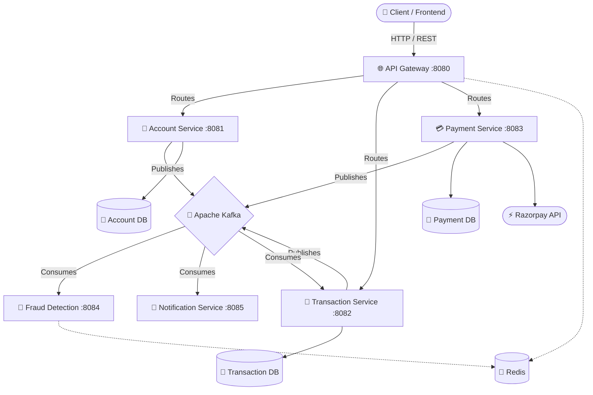

<div align="center">


A modern, highly scalable digital banking system built with **Java**, **Spring Boot**, and **Apache Kafka**.

[](https://spring.io/projects/spring-boot)
[](https://www.oracle.com/java/)
[](https://kafka.apache.org/)
[](https://www.postgresql.org/)
[](https://redis.io/)
[](https://www.docker.com/)

</div>

---

## 🚀 Features

- 🔐 **API Gateway:** Centralized routing with Redis-based rate limiting.
- 💳 **Payment Processing:** Integrated with **Razorpay** for seamless transactions.
- 🛡️ **Fraud Detection:** Real-time event analysis to block suspicious transactions.
- ⚡ **Event-Driven Architecture:** Asynchronous communication powered by Apache Kafka.
- 🔔 **Real-Time Notifications:** Instant alerts for user transactions.

---

## 🏗️ Architecture



---

## 📦 Microservices Overview

| Service | Port | Description | Tech |
| :--- | :--- | :--- | :--- |
| **API Gateway** | `8080` | Entry point, routing, and API rate limiting | Spring Cloud Gateway, Redis |
| **Account Service** | `8081` | Manages user accounts and balances | Spring Data JPA, PostgreSQL, Kafka |
| **Transaction Service** | `8082` | Handles deposits, withdrawals, and transfers | Spring Data JPA, PostgreSQL, Redis |
| **Payment Service** | `8083` | Third-party payment gateway integration | Razorpay SDK, PostgreSQL |
| **Fraud Detection** | `8084` | Monitors velocity and volume for fraud | Kafka Streams/Consumer, Redis |
| **Notification Service** | `8085` | Dispatches SMS/Email alerts asynchronously | Kafka Consumer |

---

## 🛠️ Tech Stack

- **Core:** Java 17, Spring Boot 3.x, Spring Cloud
- **Databases:** PostgreSQL (NeonDB), Redis
- **Messaging:** Apache Kafka
- **Build Tool:** Maven
- **Infrastructure:** Docker & Docker Compose

---

## 🚦 Getting Started

### Prerequisites
- JDK 17+
- Maven
- Docker & Docker Compose (for Kafka, Zookeeper, Redis)

### 1. Set Up Environment Variables
Create a `.env` file or export the following variables in your terminal to securely connect the services:

```bash
# Database Configurations
export DB_URL_ACCOUNT="jdbc:postgresql://<your-db-url>/account_db"
export DB_URL_TRANSACTION="jdbc:postgresql://<your-db-url>/transaction_db"
export DB_URL_PAYMENT="jdbc:postgresql://<your-db-url>/payment_db"
export DB_USERNAME="your-db-username"
export DB_PASSWORD="your-db-password"

# Razorpay Keys
export RAZORPAY_KEY_ID="rzp_test_xxxxxx"
export RAZORPAY_KEY_SECRET="your-razorpay-secret"
```

### 2. Start Infrastructure
Boot up the required infrastructure (Kafka and Redis) using Docker Compose:
```bash
docker-compose up -d
```

### 3. Build & Run Services
You can build and start all services using Maven. Navigate to each service directory:

```bash
# Example for Account Service
cd account-service
mvn clean install
mvn spring-boot:run
```

---

<div align="center">
  <i>Developed with ❤️ for secure and scalable banking.</i>
</div>
